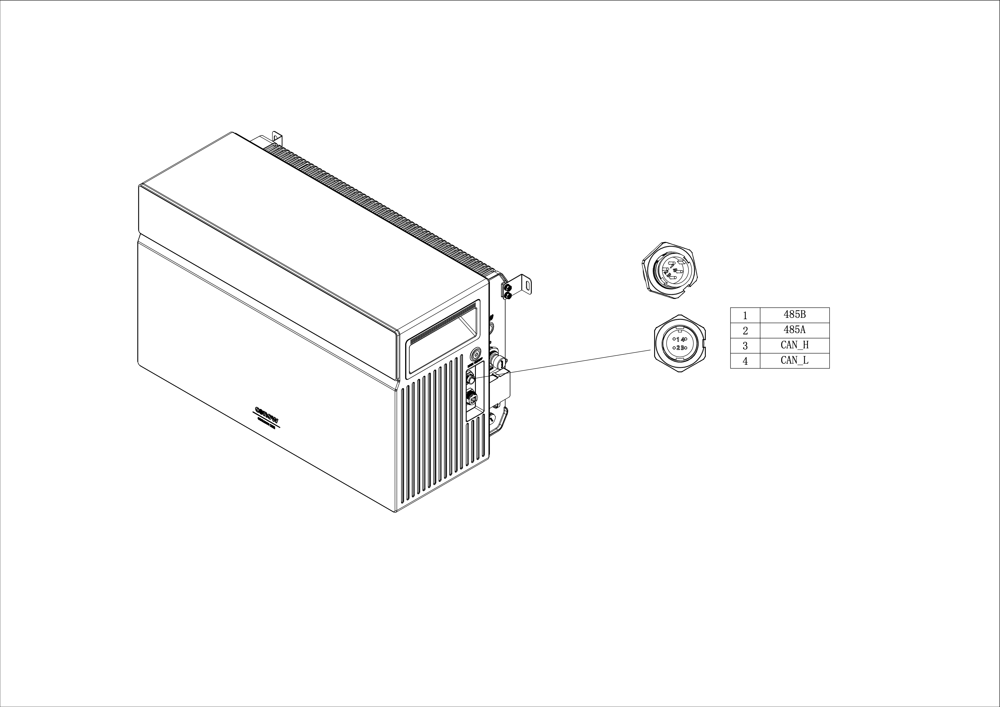
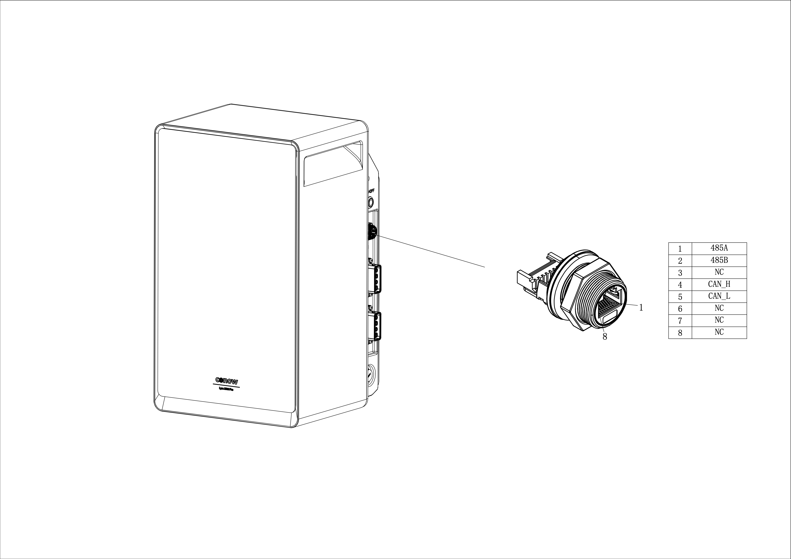

# CONOW Balkonkraftwerk-Speicher — Modbus-RTU-API-Referenz

> [!IMPORTANT]
> Gilt für Firmware unter der v2-Mindestversion (v1-Registerübersicht).
> Für Firmware ab der v2-Mindestversion gilt [balcony-solar-storage-v2.de.md](balcony-solar-storage-v2.de.md) — das v2-Firmware-Update hat neue Registeradressen hinzugefügt.

> **Haftungsausschluss:** Dieses Dokument wurde aus dem öffentlichen Kommunikationsprotokoll des Geräts erstellt und richtet sich an Entwickler und Systemintegratoren. CONOW behält sich Aktualisierungen von Dokumentation und Produktspezifikationen vor. Codebeispiele werden "wie besehen" bereitgestellt; CONOW haftet nicht für Gerätestörungen oder Sachschäden infolge unsachgemäßer Verwendung. Lies vor dem Schreiben von Steuerungsregistern unbedingt die Sicherheitshinweise des Herstellers.

Sprachen / Language / 语言 / Taal: [English](balcony-solar-storage.md) · [简体中文](balcony-solar-storage.zh-CN.md) · **Deutsch** · [Nederlands](balcony-solar-storage.nl.md)

---

## Inhaltsverzeichnis

- [1 Überblick](#1-überblick)
  - [1.1 Kommunikationsparameter](#11-kommunikationsparameter)
  - [1.2 Hardware-Schnittstelle](#12-hardware-schnittstelle)
  - [1.3 Modbus-Anfragebegrenzungen](#13-modbus-anfragebegrenzungen)
  - [1.4 Voraussetzungen](#14-voraussetzungen)
- [2 Datentypen und Einheitenumrechnung](#2-datentypen-und-einheitenumrechnung)
  - [2.1 Unterstützte Datentypen](#21-unterstützte-datentypen)
  - [2.2 Umrechnungsformel](#22-umrechnungsformel)
- [3 Registerübersicht](#3-registerübersicht)
  - [3.1 Echtzeitstatus und Monitoring (nur lesen)](#31-echtzeitstatus-und-monitoring-nur-lesen)
  - [3.2 Parametereinstellungen und Steuerung (lesen/schreiben)](#32-parametereinstellungen-und-steuerung-lesenschreiben)
- [4 Frame-Beispiele](#4-frame-beispiele)
  - [4.1 Echtzeitdaten lesen (FC 0x03)](#41-echtzeitdaten-lesen-fc-0x03)
  - [4.2 Einzelnes Register schreiben (FC 0x06)](#42-einzelnes-register-schreiben-fc-0x06)
  - [4.3 Mehrere Register schreiben (FC 0x10)](#43-mehrere-register-schreiben-fc-0x10)
- [5 Referenz](#5-referenz)
  - [5.1 Systemstatus-Bitmaske (Register 10000)](#51-systemstatus-bitmaske-register-10000)
  - [5.2 Lade-/Entladerichtungssteuerung (Register 10105)](#52-lade-entladerichtungssteuerung-register-10105)
- [6 Wichtige Hinweise](#6-wichtige-hinweise)

---

## 1 Überblick

Dieses Dokument ist die vollständige Modbus-RTU-API-Referenz für das CONOW-Balkonkraftwerk-Speichersystem. Es richtet sich an Endanwender, Entwickler und Systemintegratoren, die das Gerät an Plattformen wie Home Assistant, OpenHAB oder ein eigenes Energiemanagementsystem (EMS) anbinden und in Echtzeit überwachen und steuern möchten.

Das Gerät verwendet das Standardprotokoll **Modbus RTU** über eine RS-485-Physischnittstelle.

### 1.1 Kommunikationsparameter

Konfiguriere den Adapter auf der Host-Seite (zum Beispiel einen RS-485-auf-USB-Konverter oder einen Serial Server) vor dem Verbinden wie folgt:

| Parameter | Standardwert | Hinweise |
| --- | --- | --- |
| Standard-Geräte-ID | `0xA0` (dezimal 160) | über die Konfigurationssoftware einstellbar |
| Baudrate | `38400` bps | muss auf beiden Seiten übereinstimmen |
| Datenbits | `8` | Standard |
| Stoppbits | `1` | Standard |
| Parität | keine | Standard |

### 1.2 Hardware-Schnittstelle

#### 1.2.1 CBE2000 Pro

Modbus RTU über RS-485 durch einen 4-poligen Klemmblock.

| Pin | Signal |
| --- | --- |
| 1 | 485B |
| 2 | 485A |
| 3 | CAN_H |
| 4 | CAN_L |



#### 1.2.2 Lyra Serie und Atlas

Modbus RTU über RS-485 durch eine frontseitig montierte 8P8C-RJ45-Buchse.

| Pin | Signal | Drahtfarbe | Hinweise |
| --- | --- | --- | --- |
| 1 | 485A (Data +) | Weiß/Orange | Modbus RTU A |
| 2 | 485B (Data −) | Orange | Modbus RTU B |
| 3 | NC | — | nicht belegt |
| 4 | CAN_H | — | CAN-Bus-Signal, für Modbus ungenutzt |
| 5 | CAN_L | — | CAN-Bus-Signal, für Modbus ungenutzt |
| 6 | NC | — | nicht belegt |
| 7 | NC | — | nicht belegt |
| 8 | NC | — | nicht belegt |



> Hinweise:
>
> - Für die Modbus-RTU-Kommunikation genügen Pin 1 (485A) und Pin 2 (485B).
> - **Eine Signalmasse ist nicht vorhanden und nicht erforderlich.**

### 1.3 Modbus-Anfragebegrenzungen

> [!IMPORTANT]
> Gerätespezifische Begrenzung für Leseanfragen mit Funktionscode 0x03. Eine einzelne Leseanfrage darf **höchstens 37 Register** umfassen:
>
> - 37 Register oder weniger: normale Antwort.
> - 38 Register oder mehr: **das Gerät antwortet nicht (stumm, überhaupt keine Antwort)**.

### 1.4 Voraussetzungen

Das Gerät muss über die **CONOW ECO App** in Betrieb genommen worden sein und mindestens einmal online gegangen sein — ein fabrikneues, nie aktiviertes Gerät beantwortet keine Anfrage an der RS-485-Schnittstelle.

1. Aktiviere in der App unter *Geräte → dein Gerät → Einstellungen* die Option *Modbus-Dienst aktivieren*; fehlt der Schalter in älteren App-Versionen, wähle stattdessen unter *Einstellungen → Betriebsmodus* den *DIY-Modus*.
2. Schreibzugriffe jederzeit auf einen einzelnen Master beschränken.

---

## 2 Datentypen und Einheitenumrechnung

### 2.1 Unterstützte Datentypen

| Typ | Breite | Bereich | Hinweise |
| --- | --- | --- | --- |
| `uint16_t` | 16 Bit (1 Register) | 0–65535 | Ganzzahl ohne Vorzeichen |
| `int16_t` | 16 Bit (1 Register) | -32768 bis 32767 | Ganzzahl mit Vorzeichen; positiv = Entladen, negativ = Laden |
| `uint32_t` | 32 Bit (2 Register) | 0–4294967295 | Big-Endian; High-Word-Register zuerst, Low-Word-Register danach |

### 2.2 Umrechnungsformel

Da Modbus-Register nur Ganzzahlen aufnehmen, müssen physikalische Größen mit Dezimalgenauigkeit (zum Beispiel Spannung oder Energie) über den Skalierungsfaktor umgerechnet werden:

```text
Physikalischer Wert = (Rohwert des Registers − Offset) × Skalierungsfaktor
```

**Beispiel:** Das Lesen der *Batteriespannung* (Adresse 10002) liefert `3200`.
Skalierungsfaktor = `0.01`, Offset = `0`.
Ergebnis: `3200 × 0.01 = 32.00 V`

---

## 3 Registerübersicht

### 3.1 Echtzeitstatus und Monitoring (nur lesen)

Zugriff mit FC `0x03` oder `0x04`. Diese Register liefern Live-Betriebsdaten und historische Statistiken.

#### System und Batterie

| Adresse (dezimal) | Adresse (hexadezimal) | Name | Typ | Einheit | Skalierung | Bemerkungen |
| --- | --- | --- | --- | --- | --- | --- |
| 10000 | 0x2710 | Systemstatus | uint16_t | — | — | siehe [Abschnitt 5.1](#51-systemstatus-bitmaske-register-10000) |
| 10001 | 0x2711 | Fehlercode | uint16_t | — | — | — |
| 10002 | 0x2712 | Batteriespannung | uint16_t | V | 0.01 | — |
| 10003 | 0x2713 | Batterie-Restkapazität (SoC) | uint16_t | % | 1 | Bereich: 0–100 |
| 10004 | 0x2714 | Batterie-Nennkapazität | uint16_t | kWh | 0.01 | — |
| 10005 | 0x2715 | Max. Zelltemperatur | uint16_t | °C | 0.1 | Offset: 500; das heißt `(Rohwert − 500) × 0.1 °C` |
| 10006 | 0x2716 | Min. Zelltemperatur | uint16_t | °C | 0.1 | Offset: 500; das heißt `(Rohwert − 500) × 0.1 °C` |
| 10007–10008 | 0x2717 | Ladeenergie Batterie gesamt | uint32_t | kWh | 0.01 | belegt Register 10007–10008 |
| 10009–10010 | 0x2719 | Entladeenergie Batterie gesamt | uint32_t | kWh | 0.01 | belegt Register 10009–10010 |

#### Netz und Bypass

| Adresse (dezimal) | Adresse (hexadezimal) | Name | Typ | Einheit | Skalierung | Bemerkungen |
| --- | --- | --- | --- | --- | --- | --- |
| 10011 | 0x271B | Netz-Wirkleistung | int16_t | W | 1 | CBE: positiv = Einspeisung, negativ = Bezug; Lyra / Atlas: positiv = Bezug, negativ = Einspeisung |
| 10012 | 0x271C | Netzfrequenz | uint16_t | Hz | 1 | zum Beispiel Rohwert `50` = 50 Hz |
| 10013–10014 | 0x271D | Netzbezug gesamt | uint32_t | kWh | 0.01 | belegt Register 10013–10014 |
| 10015–10016 | 0x271F | Netzeinspeisung gesamt | uint32_t | kWh | 0.01 | belegt Register 10015–10016 |
| 10017 | 0x2721 | Bypass-Leistung | int16_t | W | 1 | positiv = Entladen; negativ = Laden |
| 10018–10019 | 0x2722 | Bypass-Ausgangsenergie gesamt | uint32_t | kWh | 0.01 | belegt Register 10018–10019 |
| 10020–10021 | 0x2724 | Bypass-Eingangsenergie gesamt | uint32_t | kWh | 0.01 | belegt Register 10020–10021 |

#### PV-Eingang

| Adresse (dezimal) | Adresse (hexadezimal) | Name | Typ | Einheit | Skalierung | Bemerkungen |
| --- | --- | --- | --- | --- | --- | --- |
| 10022 | 0x2726 | PV-Gesamteingangsleistung | uint16_t | W | 1 | Summe aller PV-Kanäle |
| 10023–10024 | 0x2727 | PV-Energie gesamt | uint32_t | kWh | 0.01 | belegt Register 10023–10024 |
| 10025 | 0x2729 | PV1-Eingangsleistung | uint16_t | W | 1 | — |
| 10026–10027 | 0x272A | PV1-Energie gesamt | uint32_t | kWh | 0.01 | belegt Register 10026–10027 |
| 10028 | 0x272C | PV2-Eingangsleistung | uint16_t | W | 1 | — |
| 10029–10030 | 0x272D | PV2-Energie gesamt | uint32_t | kWh | 0.01 | belegt Register 10029–10030 |
| 10031 | 0x272F | PV3-Eingangsleistung | uint16_t | W | 1 | — |
| 10032–10033 | 0x2730 | PV3-Energie gesamt | uint32_t | kWh | 0.01 | belegt Register 10032–10033 |
| 10034 | 0x2732 | PV4-Eingangsleistung | uint16_t | W | 1 | — |
| 10035–10036 | 0x2733 | PV4-Energie gesamt | uint32_t | kWh | 0.01 | belegt Register 10035–10036 |

---

### 3.2 Parametereinstellungen und Steuerung (lesen/schreiben)

Zugriff mit FC `0x03` (lesen) oder FC `0x06` / `0x10` (schreiben).

| Adresse (dezimal) | Adresse (hexadezimal) | Name | Typ | Einheit | Skalierung | Bemerkungen |
| --- | --- | --- | --- | --- | --- | --- |
| 10100 | 0x2774 | AC-Ladeleistungslimit | uint16_t | W | 1 | maximale Ladeleistung Netz → Batterie; Standard 800 |
| 10101 | 0x2775 | Entladeleistungslimit | uint16_t | W | 1 | maximale Ausgangsleistung im Netzparallelbetrieb; Standard 800 |
| 10102 | 0x2776 | Backup-SoC | uint16_t | % | 1 | für Notstrom reservierter SoC; 10–100 |
| 10103 | 0x2777 | Notstrom-Ausgangsschalter | uint16_t | — | — | `0` = aus, `1` = ein |
| 10104 | 0x2778 | PV-Abregelungsschalter | uint16_t | — | — | `0` = aus (Laden-/Netzparallelbetrieb-Priorität), `1` = ein (PV-Eingang begrenzen) |
| 10105 | 0x2779 | Lade-/Entladerichtungssteuerung | uint16_t | — | — | `0` = inaktiv, `1` = Laden erzwingen, `2` = Entladen erzwingen |
| 10106 | 0x277A | Ziel-Lade-/Entladeleistung | uint16_t | W | — | zusammen mit Register 10105 verwenden; legt den tatsächlichen Leistungssollwert fest |
| 10107 | 0x277B | Lade-/Entlade-Abschalt-SoC | uint16_t | % | — | Ladeobergrenze oder Entladeuntergrenze; 10–100 |

> [!WARNING]
> **Schreibreihenfolge für erzwungenes Laden/Entladen (FC 0x06):**
> Beim Schreiben der Register einzeln immer in dieser Reihenfolge vorgehen: **10106 (Leistung) → 10105 (Richtung) → 10107 (Abschalt-SoC)**.
> Empfehlung: atomar schreiben — 10105 und 10106 gemeinsam in einem FC `0x10`-Frame schreiben; wenn zusätzlich 10107 geschrieben werden muss, die FC-`0x06`-Reihenfolge oben einhalten.

---

## 4 Frame-Beispiele

Alle Frames verwenden die Modbus-RTU-Kodierung. Die CRC-16 wird über alle vorangehenden Bytes mit dem Standard-Modbus-Polynom (`0xA001`, reflektiert) berechnet.

### 4.1 Echtzeitdaten lesen (FC 0x03)

**Ziel:** die *Batteriespannung* lesen — Register `10002` (0x2712), 1 Register.

**Anfrage:**

```text
A0  03  27 12  00 01  37 CA
│   │   └───┘  └───┘  └───┘
│   │     │      │      └── CRC16 (Little-Endian)
│   │     │      └── Anzahl: 1 Register
│   │     └── Startadresse: 0x2712 (10002)
│   └── Funktionscode: 0x03
└── Geräteadresse: 0xA0
```

**Antwort** (Beispiel — Batterie bei 32.00 V):

```text
A0  03  02  0C 80  01 3D
│   │   │   └───┘  └───┘
│   │   │     │      └── CRC16
│   │   │     └── Daten: 0x0C80 = 3200 → 3200 × 0.01 = 32.00 V
│   │   └── Byteanzahl: 2
│   └── Funktionscode-Echo: 0x03
└── Geräteadresse-Echo: 0xA0
```

---

### 4.2 Einzelnes Register schreiben (FC 0x06)

**Ziel:** den Notstrom-Ausgangsschalter aktivieren — Register `10103` (0x2777), Wert `1`.

**Anfrage:**

```text
A0  06  27 77  00 01  EB D5
│   │   └───┘  └───┘  └───┘
│   │     │      │      └── CRC16
│   │     │      └── Wert: 0x0001 (ein)
│   │     └── Registeradresse: 0x2777 (10103)
│   └── Funktionscode: 0x06
└── Geräteadresse: 0xA0
```

**Antwort:** Das Gerät sendet den Anfrage-Frame bei Erfolg unverändert zurück.

---

### 4.3 Mehrere Register schreiben (FC 0x10)

**Ziel:** Laden mit 1000 W erzwingen — Richtung (10105) und Leistung (10106) in einem einzigen atomaren Frame schreiben.

> [!NOTE]
> Dieses Beispiel schreibt mit FC `0x10` zwei aufeinanderfolgende Register ab **10105**.
> Die Reihenfolge im Datenfeld folgt der Modbus-Registeradressreihenfolge: `[10105=0x0001 (Laden), 10106=0x03E8 (1000 W)]`.
> Dies weicht von der **FC-0x06-Einzelschreibreihenfolge** (10106 → 10105 → 10107) aus [Abschnitt 3.2](#32-parametereinstellungen-und-steuerung-lesenschreiben) ab. Wenn diese Reihenfolge exakt einzuhalten ist (zum Beispiel beim zusätzlichen Schreiben von 10107), verwende FC `0x06`.

**Anfrage:**

```text
A0  10  27 79  00 02  04  00 01  03 E8  DC 90
│   │   └───┘  └───┘  │   └───┘  └───┘  └───┘
│   │     │      │    │     │      │      └── CRC16
│   │     │      │    │     │      └── Register 10106: 0x03E8 (1000 W)
│   │     │      │    │     └── Register 10105: 0x0001 (Laden erzwingen)
│   │     │      │    └── Byteanzahl: 4 (2 Register × 2 Bytes)
│   │     │      └── Anzahl: 2 Register
│   │     └── Startadresse: 0x2779 (10105)
│   └── Funktionscode: 0x10
└── Geräteadresse: 0xA0
```

**Antwort:**

```text
A0  10  27 79  00 02  83 D4
│   │   └───┘  └───┘  └───┘
│   │     │      │      └── CRC16
│   │     │      └── Anzahl: 2 Register
│   │     └── Startadresse: 0x2779 (10105)
│   └── Funktionscode-Echo: 0x10
└── Geräteadresse-Echo: 0xA0
```

> Einzelne Register mit FC `0x06` schreiben; atomare Mehrfach-Schreibzugriffe mit FC `0x10`.

---

## 5 Referenz

### 5.1 Systemstatus-Bitmaske (Register 10000)

Register 10000 (Systemstatus) meldet den aktuellen Zustand des Batterieanschlusses als Bitfeld. Jedes Bit ist unabhängig auszuwerten; Bit 0 ist das niederwertigste Bit (LSB).

| Bit | Bezeichnung | Bedeutung |
| --- | --- | --- |
| Bit 0 | Bereitschaft | `0` = nicht in Bereitschaft, `1` = Batterieanschluss in Bereitschaft |
| Bit 1 | / | reserviert |
| Bit 2 | Fehler | `0` = in Ordnung, `1` = aktiver Fehler (Register 10001 lesen) |
| Bit 3 | Laden | `0` = nein, `1` = Batterieanschluss lädt |
| Bit 4 | Entladen | `0` = nein, `1` = Batterieanschluss entlädt |
| Bit 5–15 | reserviert | ignorieren; für zukünftige Verwendung |

**Beispiel:** Register 10000 liefert `0x0008` (binär `0000 1000`) — nur Bit 3 ist 1, alle übrigen 0. In der Tabelle nachschlagen: Bit 3 (Laden) = 1 — der Batterieanschluss lädt. Ebenso bedeutet `0x0001` (binär `0000 0001`), dass nur Bit 0 (Bereitschaft) = 1 ist — der Batterieanschluss ist im Bereitschaftszustand.

---

### 5.2 Lade-/Entladerichtungssteuerung (Register 10105)

| Wert | Modus | Verhalten |
| --- | --- | --- |
| 0x0000 | Inaktiv | erzwungenen Modus beenden |
| 0x0001 | Laden erzwingen | Netz → Batterie; Leistung über Register 10106; Stopp beim SoC aus Register 10107 |
| 0x0002 | Entladen erzwingen | Batterie → Netz/Verbraucher; Leistung über Register 10106; Stopp beim SoC aus Register 10107 |

> [!WARNING]
> **Schreibreihenfolge (FC 0x06):** `10106 (Leistung)` → `10105 (Richtung)` → `10107 (Abschalt-SoC)`.
> Empfehlung: atomar schreiben — 10105 und 10106 gemeinsam in einem FC `0x10`-Frame schreiben; wenn zusätzlich 10107 geschrieben werden muss, die FC-`0x06`-Reihenfolge oben einhalten.
> Erzwungenen Modus beenden: `0x0000` in Register 10105 schreiben.

---

## 6 Wichtige Hinweise

1. **Big-Endian-Wortreihenfolge:** Alle `uint32_t`-Werte erstrecken sich über zwei aufeinanderfolgende 16-Bit-Register. Das High-Word-Register hat die niedrigere Adresse. Den 32-Bit-Wert wie folgt rekonstruieren:
  ```c
   uint32_t value = ((uint32_t)reg_high << 16) | reg_low;
  ```
2. **CRC-Prüfung:** Frames mit falscher CRC-16 verwirft das Gerät stillschweigend. Bleibt eine Anfrage ohne Antwort, zuerst die CRC prüfen, bevor Verdrahtung oder Adressen verdächtigt werden.
3. **Wertebereichs-Prüfung:** Schreibzugriffe auf Lese-/Schreibregister mit Werten außerhalb des erlaubten Bereichs ignoriert das Gerät oder antwortet mit einer Modbus-Exception.
4. **Wiederholungsstrategie:** RS-485 ist anfällig für elektromagnetische Störungen. Implementiere bei Timeout oder CRC-Fehler eine Wiederholung von höchstens **3 Versuchen** mit jeweils mindestens **500 ms** Abstand.
5. **Poll-Intervall:** Das Poll-Intervall für Echtzeitdaten darf **nicht kürzer als 2 Sekunden** sein. Zu häufiges Pollen kann den RS-485-Bus sättigen und dazu führen, dass Antworten verloren gehen.
