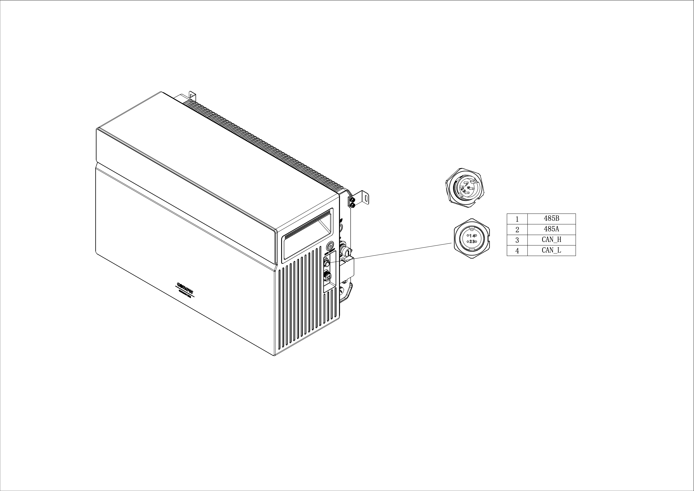
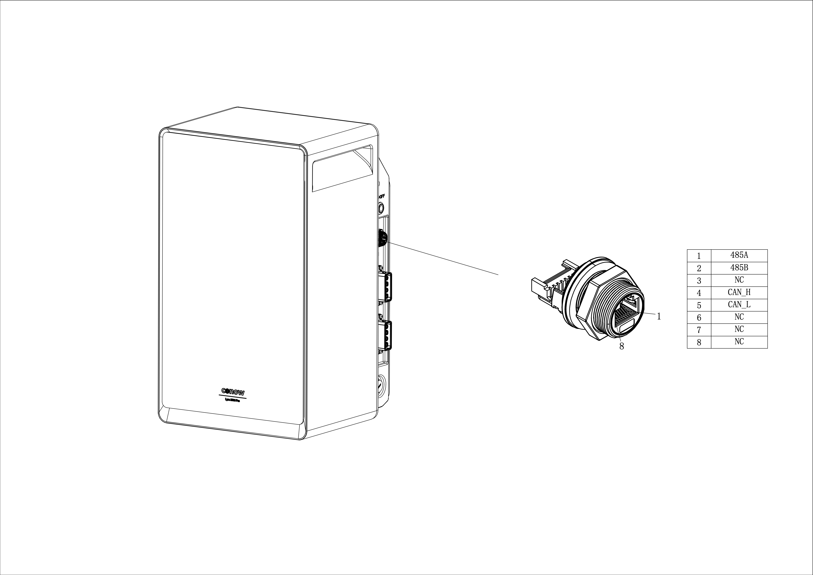

# CONOW Balcony Solar Storage — Modbus RTU API Reference

> [!IMPORTANT]
> Applies to firmware below the per-model v2 minimum (v1 register map).
> For firmware at or above the v2 minimum, use [balcony-solar-storage-v2.md](balcony-solar-storage-v2.md) — the v2 firmware update added new register addresses.

> **Disclaimer:** This document is compiled from the device's public communication protocol for reference by developers and system integrators. Conow reserves the right to update document content and product specifications. Code examples are provided "as is"; Conow is not liable for device malfunction or property damage resulting from improper use. Always read the manufacturer's safety instructions before modifying control registers.

Languages / 语言 / Sprachen / Talen: **English** · [简体中文](balcony-solar-storage.zh-CN.md) · [Deutsch](balcony-solar-storage.de.md) · [Nederlands](balcony-solar-storage.nl.md)

---

## Table of Contents

- [1 Overview](#1-overview)
  - [1.1 Communication parameters](#11-communication-parameters)
  - [1.2 Hardware interface](#12-hardware-interface)
  - [1.3 Modbus request limitations](#13-modbus-request-limitations)
  - [1.4 Prerequisites](#14-prerequisites)
- [2 Data types and unit conversion](#2-data-types-and-unit-conversion)
  - [2.1 Supported data types](#21-supported-data-types)
  - [2.2 Conversion formula](#22-conversion-formula)
- [3 Register map](#3-register-map)
  - [3.1 Real-time status and monitoring (read-only)](#31-real-time-status-and-monitoring-read-only)
  - [3.2 Parameter settings and control (read/write)](#32-parameter-settings-and-control-readwrite)
- [4 Frame examples](#4-frame-examples)
  - [4.1 Read real-time data (FC 0x03)](#41-read-real-time-data-fc-0x03)
  - [4.2 Write single register (FC 0x06)](#42-write-single-register-fc-0x06)
  - [4.3 Write multiple registers (FC 0x10)](#43-write-multiple-registers-fc-0x10)
- [5 Reference](#5-reference)
  - [5.1 System status bit map (register 10000)](#51-system-status-bit-map-register-10000)
  - [5.2 Charge/discharge direction control (register 10105)](#52-chargedischarge-direction-control-register-10105)
- [6 Important notes](#6-important-notes)

---

## 1 Overview

This document provides a complete Modbus RTU API reference for the CONOW Balcony Solar Storage system. It is intended for end users, developers, and system integrators who wish to connect the device to platforms such as Home Assistant, OpenHAB, or a custom Energy Management System (EMS) for real-time monitoring and control.

The device uses the standard **Modbus RTU** protocol over an RS-485 physical interface.

### 1.1 Communication parameters

Configure your host-side adapter (such as an RS-485 to USB converter or serial server) with the following settings before connecting:

| Parameter         | Default Value     | Notes                           |
| ----------------- | ----------------- | ------------------------------- |
| Default Device ID | `0xA0` (dec: 160) | Configurable with the setup software |
| Baud Rate         | `38400` bps       | Must match on both sides        |
| Data Bits         | `8`               | Standard                        |
| Stop Bits         | `1`               | Standard                        |
| Parity            | `None`            | Standard                        |

### 1.2 Hardware interface

#### 1.2.1 CBE2000 Pro

Modbus RTU over RS-485 through a 4-pin terminal block. 

| Pin | Signal |
| --- | ------ |
| 1   | 485B   |
| 2   | 485A   |
| 3   | CAN_H  |
| 4   | CAN_L  |



#### 1.2.2 Lyra Series and Atlas

Modbus RTU over RS-485 through a panel-mount 8P8C RJ45 connector. 

| Pin | Signal        | Wire Color   | Notes                             |
| --- | ------------- | ------------ | --------------------------------- |
| 1   | 485A (Data +) | White/Orange | Modbus RTU A                      |
| 2   | 485B (Data -) | Orange       | Modbus RTU B                      |
| 3   | NC            | —            | No connection                     |
| 4   | CAN_H         | —            | CAN bus signal, unused for Modbus |
| 5   | CAN_L         | —            | CAN bus signal, unused for Modbus |
| 6   | NC            | —            | No connection                     |
| 7   | NC            | —            | No connection                     |
| 8   | NC            | —            | No connection                     |



> Notes:
>
> - Only Pin1 (485A) and Pin2 (485B) are required for Modbus RTU communication.
> - **Signal ground is not available and not required.**

### 1.3 Modbus request limitations

> [!IMPORTANT]
> Device-specific limitation for read requests using Function Code 0x03. A single read request **must not request more than 37 registers**:
>
> - Requesting 37 registers or fewer: normal response returned.
> - Requesting 38 registers or more: **the device returns nothing (silent, no reply at all)**.

### 1.4 Prerequisites

The device must have been commissioned in the **CONOW ECO app** and have been online at least once — a factory-fresh, never-activated device does not respond to any request on the RS-485 interface.

1. In the app, go to *Devices → your device → Settings* and turn on *Enable Modbus service*; on older app versions the switch is absent — use *Settings → Operation Mode* and select *DIY Mode* instead.
2. Keep writes to a single master at a time.

---

## 2 Data types and unit conversion

### 2.1 Supported data types

| Type       | Width                | Range          | Notes                                                          |
| ---------- | -------------------- | -------------- | -------------------------------------------------------------- |
| `uint16_t` | 16-bit (1 register)  | 0–65535        | Unsigned integer                                               |
| `int16_t`  | 16-bit (1 register)  | -32768 to 32767 | Signed integer; positive = discharge, negative = charge        |
| `uint32_t` | 32-bit (2 registers) | 0–4294967295   | Big-Endian; high-word register first, low-word register second |

### 2.2 Conversion formula

Because Modbus registers hold integers only, physical quantities with decimal precision (for example, voltage or energy) must be scaled:

```text
Physical Value = (Raw Register Value − Offset) × Scale Factor
```

**Example:** Reading *Battery Voltage* (address 10002) returns `3200`.  
Scale factor = `0.01`, offset = `0`.  
Result: `3200 × 0.01 = 32.00 V`

---

## 3 Register map

### 3.1 Real-time status and monitoring (read-only)

Access with FC `0x03` or `0x04`. These registers expose live operating data and historical statistics.

#### System and battery

| Address (dec) | Address (hex) | Name                                | Type     | Unit | Scale | Remarks                                                     |
| ------------- | ------------- | ----------------------------------- | -------- | ---- | ----- | ----------------------------------------------------------- |
| 10000         | 0x2710        | System Status                       | uint16_t | —    | —     | See [Section 5.1](#51-system-status-bit-map-register-10000) |
| 10001         | 0x2711        | Fault Code Definition               | uint16_t | —    | —     | —                                                           |
| 10002         | 0x2712        | Battery Voltage                     | uint16_t | V    | 0.01  | —                                                           |
| 10003         | 0x2713        | Battery Remaining Capacity (SOC)    | uint16_t | %    | 1     | Range: 0–100                                              |
| 10004         | 0x2714        | Battery Design Capacity             | uint16_t | kWh  | 0.01  | —                                                           |
| 10005         | 0x2715        | Cell Temp (Max)                     | uint16_t | °C   | 0.1   | Offset: 500; that is, `(raw − 500) × 0.1 °C`                    |
| 10006         | 0x2716        | Cell Temp (Min)                     | uint16_t | °C   | 0.1   | Offset: 500; that is, `(raw − 500) × 0.1 °C`                    |
| 10007–10008   | 0x2717        | Battery Cumulative Charge Energy    | uint32_t | kWh  | 0.01  | Occupies registers 10007–10008                              |
| 10009–10010   | 0x2719        | Battery Cumulative Discharge Energy | uint32_t | kWh  | 0.01  | Occupies registers 10009–10010                              |

#### Grid and bypass

| Address (dec) | Address (hex) | Name                            | Type     | Unit | Scale | Remarks                                   |
| ------------- | ------------- | ------------------------------- | -------- | ---- | ----- | --------------------------------------- |
| 10011         | 0x271B        | Grid Active Power               | int16_t  | W    | 1     | CBE: positive = feed-in, negative = import; Lyra / Atlas: positive = import, negative = feed-in |
| 10012         | 0x271C        | Grid Frequency                  | uint16_t | Hz   | 1     | For example, raw `50` = 50 Hz                   |
| 10013–10014   | 0x271D        | Cumulative Grid Import Energy   | uint32_t | kWh  | 0.01  | Occupies registers 10013–10014          |
| 10015–10016   | 0x271F        | Cumulative Grid Export Energy   | uint32_t | kWh  | 0.01  | Occupies registers 10015–10016          |
| 10017         | 0x2721        | Bypass Power                    | int16_t  | W    | 1     | Positive = discharge; negative = charge |
| 10018–10019   | 0x2722        | Bypass Cumulative Output Energy | uint32_t | kWh  | 0.01  | Occupies registers 10018–10019          |
| 10020–10021   | 0x2724        | Bypass Cumulative Input Energy  | uint32_t | kWh  | 0.01  | Occupies registers 10020–10021          |

#### PV input

| Address (dec) | Address (hex) | Name                       | Type     | Unit | Scale | Remarks                          |
| ------------- | ------------- | -------------------------- | -------- | ---- | ----- | ------------------------------ |
| 10022         | 0x2726        | PV Total Input Power       | uint16_t | W    | 1     | Sum of all PV channel inputs   |
| 10023–10024   | 0x2727        | PV Cumulative Total Energy | uint32_t | kWh  | 0.01  | Occupies registers 10023–10024 |
| 10025         | 0x2729        | PV1 Input Power            | uint16_t | W    | 1     | —                              |
| 10026–10027   | 0x272A        | PV1 Cumulative Energy      | uint32_t | kWh  | 0.01  | Occupies registers 10026–10027 |
| 10028         | 0x272C        | PV2 Input Power            | uint16_t | W    | 1     | —                              |
| 10029–10030   | 0x272D        | PV2 Cumulative Energy      | uint32_t | kWh  | 0.01  | Occupies registers 10029–10030 |
| 10031         | 0x272F        | PV3 Input Power            | uint16_t | W    | 1     | —                              |
| 10032–10033   | 0x2730        | PV3 Cumulative Energy      | uint32_t | kWh  | 0.01  | Occupies registers 10032–10033 |
| 10034         | 0x2732        | PV4 Input Power            | uint16_t | W    | 1     | —                              |
| 10035–10036   | 0x2733        | PV4 Cumulative Energy      | uint32_t | kWh  | 0.01  | Occupies registers 10035–10036 |

---

### 3.2 Parameter settings and control (read/write)

Access with FC `0x03` (read) or FC `0x06` / `0x10` (write).

| Address (dec) | Address (hex) | Name | Type | Unit | Scale | Remarks |
| --- | --- | --- | --- | --- | --- | --- |
| 10100 | 0x2774 | AC Charge Power Limit | uint16_t | W | 1 | Max grid-to-battery charge power; default 800 |
| 10101 | 0x2775 | Discharge Power Limit | uint16_t | W | 1 | Max grid-tie output power; default 800 |
| 10102 | 0x2776 | Backup SOC | uint16_t | % | 1 | Reserved SOC for backup power; 10–100 |
| 10103 | 0x2777 | Off-Grid Output Switch | uint16_t | — | — | `0` = off, `1` = on |
| 10104 | 0x2778 | PV Curtailment Switch | uint16_t | — | — | `0` = off (charge / grid-tie priority), `1` = on (limit PV input) |
| 10105 | 0x2779 | Charge/Discharge Direction Control | uint16_t | — | — | `0` = idle, `1` = force charge, `2` = force discharge |
| 10106 | 0x277A | Target Charge/Discharge Power | uint16_t | W | — | Used with register 10105; sets the actual power setpoint |
| 10107 | 0x277B | Charge/Discharge Cutoff SOC | uint16_t | % | — | Charge upper limit or discharge lower limit; 10–100 |

> [!WARNING]
> **Write order for forced charge/discharge (FC 0x06):**  
> When writing registers one at a time, always write in this order: **10106 (power) → 10105 (direction) → 10107 (cutoff SOC)**.  
> Prefer an atomic write: send 10105 and 10106 in a single FC 0x10 frame; when also writing 10107, follow the FC 0x06 sequence above.

---

## 4 Frame examples

All frames use Modbus RTU encoding. CRC-16 is calculated over all preceding bytes using the standard Modbus polynomial (`0xA001`, reflected).

### 4.1 Read real-time data (FC 0x03)

**Goal:** Read *Battery Voltage* — register `10002` (0x2712), 1 register.

**Request:**

```text
A0  03  27 12  00 01  37 CA
│   │   └───┘  └───┘  └───┘
│   │     │      │      └── CRC16 (Little-endian)
│   │     │      └── Quantity: 1 register
│   │     └── Start address: 0x2712 (10002)
│   └── Function code: 0x03
└── Device address: 0xA0
```

**Response (example — battery at 32.00 V):**

```text
A0  03  02  0C 80  01 3D
│   │   │   └───┘  └───┘
│   │   │     │      └── CRC16
│   │   │     └── Data: 0x0C80 = 3200 → 3200 × 0.01 = 32.00 V
│   │   └── Byte count: 2
│   └── Function code echo: 0x03
└── Device address echo: 0xA0
```

---

### 4.2 Write single register (FC 0x06)

**Goal:** Turn on the off-grid output switch — register `10103` (0x2777), value `1`.

**Request:**

```text
A0  06  27 77  00 01  EB D5
│   │   └───┘  └───┘  └───┘
│   │     │      │      └── CRC16
│   │     │      └── Value: 0x0001 (on)
│   │     └── Register address: 0x2777 (10103)
│   └── Function code: 0x06
└── Device address: 0xA0
```

**Response:** The device echoes the request frame verbatim on success.

---

### 4.3 Write multiple registers (FC 0x10)

**Goal:** Force charge at 1000 W — write direction (10105) and power (10106) in one atomic frame.

> [!NOTE]
> This example uses FC `0x10` to write two consecutive registers starting at **10105**.  
> The data field order follows Modbus register address order: `[10105=0x0001 (charge), 10106=0x03E8 (1000 W)]`.  
> This differs from the **FC 0x06 sequential write order** (10106 → 10105 → 10107) described in [Section 3.2](#32-parameter-settings-and-control-readwrite). Use FC `0x06` when you need to follow that sequence exactly (for example, when also writing 10107).

**Request:**

```text
A0  10  27 79  00 02  04  00 01  03 E8  DC 90
│   │   └───┘  └───┘  │   └───┘  └───┘  └───┘
│   │     │      │    │     │      │      └── CRC16
│   │     │      │    │     │      └── Reg 10106: 0x03E8 (1000 W)
│   │     │      │    │     └── Reg 10105: 0x0001 (force charge)
│   │     │      │    └── Byte count: 4 (2 registers × 2 bytes)
│   │     │      └── Quantity: 2 registers
│   │     └── Start address: 0x2779 (10105)
│   └── Function code: 0x10
└── Device address: 0xA0
```

**Response:**

```text
A0  10  27 79  00 02  83 D4
│   │   └───┘  └───┘  └───┘
│   │     │      │      └── CRC16
│   │     │      └── Quantity: 2 registers
│   │     └── Start address: 0x2779 (10105)
│   └── Function code echo: 0x10
└── Device address echo: 0xA0
```

> Use FC `0x06` when writing only a single register. Use FC `0x10` for atomic multi-register writes.

---

## 5 Reference

### 5.1 System status bit map (register 10000)

Register 10000 (system status) reports the current state of the battery port as a bit field. Parse each bit independently; Bit 0 is the LSB.

| Bit      | Description | Meaning                                               |
| -------- | ----------- | ---------------------------------------------------- |
| Bit 0    | Standby     | `0` = not in standby, `1` = battery port in standby  |
| Bit 1    | /           | Reserved                                             |
| Bit 2    | Fault       | `0` = healthy, `1` = fault active (read reg 10001)   |
| Bit 3    | Charging    | `0` = no, `1` = battery port is charging             |
| Bit 4    | Discharging | `0` = no, `1` = battery port is discharging          |
| Bit 5–15 | Reserved    | Ignore; reserved for future use                      |

**Example:** register 10000 returns `0x0008` (binary `0000 1000`). Only Bit 3 is 1; all other bits are 0. Looking it up in the table: Bit 3 (Charging) = 1 — the battery port is charging. Likewise, a read of `0x0001` (binary `0000 0001`) means only Bit 0 (Standby) = 1 — the battery port is in standby.

---

### 5.2 Charge/discharge direction control (register 10105)

| Value  | Mode            | Behavior                                                                   |
| ------ | --------------- | -------------------------------------------------------------------------- |
| 0x0000 | Idle            | Exit forced mode                                                       |
| 0x0001 | Force Charge    | Grid → battery; power set by reg 10106; stops at SOC set by reg 10107      |
| 0x0002 | Force Discharge | Battery → grid/load; power set by reg 10106; stops at SOC set by reg 10107 |

> [!WARNING]
> **Write sequence (FC 0x06):** `10106 (power)` → `10105 (direction)` → `10107 (cutoff SOC)`.  
> Prefer an atomic write: send 10105 and 10106 in a single FC 0x10 frame; when also writing 10107, follow the FC 0x06 sequence above.  
> To stop forced mode: write `0x0000` to register 10105.

---

## 6 Important notes

1. **Big-Endian word order:** All `uint32_t` values span two consecutive 16-bit registers. The high-word register has the lower address. Reconstruct the 32-bit value as:
  ```c
   uint32_t value = ((uint32_t)reg_high << 16) | reg_low;
  ```
2. **CRC validation:** The device silently discards any frame with an incorrect CRC-16. If a request receives no response, verify the CRC before suspecting wiring or address issues.
3. **Write range enforcement:** The device ignores writes to read/write registers whose value falls outside the permitted range, or may return a Modbus exception response.
4. **Retry strategy:** RS-485 is susceptible to electromagnetic interference. Implement a retry mechanism of up to **3 attempts** with a minimum interval of **500 ms** between each attempt on timeout or CRC error.
5. **Polling interval:** The polling interval for real-time data must **not be shorter than 2 seconds**. Excessive polling can saturate the RS-485 bus and cause missed responses.
