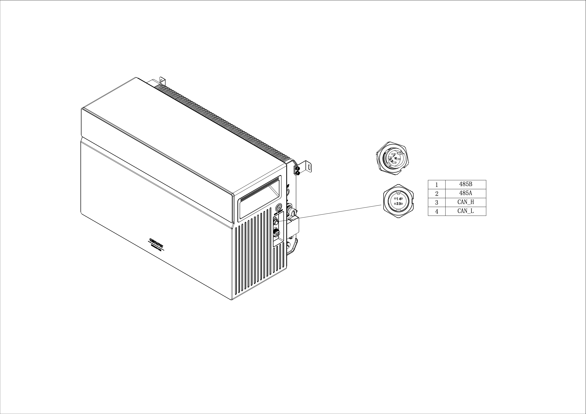
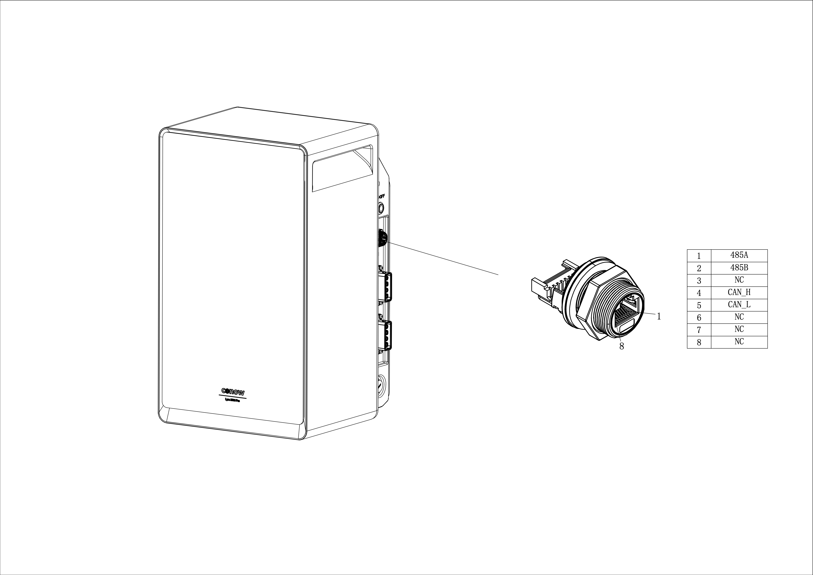

# CONOW Balkon-zonne-energieopslag — Modbus RTU API-referentie

> [!IMPORTANT]
> Van toepassing op firmware onder de v2-minimumversie (v1-registeroverzicht).
> Voor firmware vanaf de v2-minimumversie geldt [balcony-solar-storage-v2.nl.md](balcony-solar-storage-v2.nl.md) — de v2-firmware-update heeft nieuwe registeradressen toegevoegd.

> **Disclaimer:** Dit document is samengesteld aan de hand van het openbare communicatieprotocol van het apparaat en dient als referentie voor ontwikkelaars en systeemintegrators. CONOW behoudt zich het recht voor de documentatie en productspecificaties aan te passen. Codevoorbeelden worden geleverd "in de huidige staat"; CONOW is niet aansprakelijk voor apparaatstoringen of materiële schade als gevolg van onjuist gebruik. Lees vóór het schrijven van besturingsregisters altijd de veiligheidsinstructies van de fabrikant.

Talen / Language / 语言 / Sprache: [English](balcony-solar-storage.md) · [简体中文](balcony-solar-storage.zh-CN.md) · [Deutsch](balcony-solar-storage.de.md) · **Nederlands**

---

## Inhoudsopgave

- [1 Overzicht](#1-overzicht)
  - [1.1 Communicatieparameters](#11-communicatieparameters)
  - [1.2 Hardware-interface](#12-hardware-interface)
  - [1.3 Modbus-verzoekbeperkingen](#13-modbus-verzoekbeperkingen)
  - [1.4 Vereisten](#14-vereisten)
- [2 Datatypes en eenheidsomrekening](#2-datatypes-en-eenheidsomrekening)
  - [2.1 Ondersteunde datatypes](#21-ondersteunde-datatypes)
  - [2.2 Omrekeningsformule](#22-omrekeningsformule)
- [3 Registeroverzicht](#3-registeroverzicht)
  - [3.1 Realtime status en monitoring (alleen lezen)](#31-realtime-status-en-monitoring-alleen-lezen)
  - [3.2 Parameterinstellingen en besturing (lezen/schrijven)](#32-parameterinstellingen-en-besturing-lezenschrijven)
- [4 Framevoorbeelden](#4-framevoorbeelden)
  - [4.1 Realtimegegevens lezen (FC 0x03)](#41-realtimegegevens-lezen-fc-0x03)
  - [4.2 Één register schrijven (FC 0x06)](#42-één-register-schrijven-fc-0x06)
  - [4.3 Meerdere registers schrijven (FC 0x10)](#43-meerdere-registers-schrijven-fc-0x10)
- [5 Referentie](#5-referentie)
  - [5.1 Systeemstatus-bitmasker (register 10000)](#51-systeemstatus-bitmasker-register-10000)
  - [5.2 Laad-/ontlaadrichtingsbesturing (register 10105)](#52-laad-ontlaadrichtingsbesturing-register-10105)
- [6 Belangrijke opmerkingen](#6-belangrijke-opmerkingen)

---

## 1 Overzicht

Dit document is de volledige Modbus RTU API-referentie voor het CONOW-systeem voor balkon-zonne-energieopslag. Het is bedoeld voor eindgebruikers, ontwikkelaars en systeemintegrators die het apparaat willen koppelen aan platforms zoals Home Assistant, OpenHAB of een eigen energiemanagementsysteem (EMS) voor realtime monitoring en besturing.

Het apparaat gebruikt het standaardprotocol **Modbus RTU** over een RS-485-fysieke interface.

### 1.1 Communicatieparameters

Configureer de adapter aan de hostzijde (zoals een RS-485-naar-USB-converter of een seriële server) vóór het verbinden als volgt:

| Parameter | Standaardwaarde | Opmerkingen |
| --- | --- | --- |
| Standaard apparaat-ID | `0xA0` (decimaal 160) | instelbaar via de configuratiesoftware |
| Baudsnelheid | `38400` bps | moet aan beide zijden gelijk zijn |
| Databits | `8` | standaard |
| Stopbits | `1` | standaard |
| Pariteit | geen | standaard |

### 1.2 Hardware-interface

#### 1.2.1 CBE2000 Pro

Modbus RTU over RS-485 via een 4-polige aansluitklem.

| Pin | Signaal |
| --- | --- |
| 1 | 485B |
| 2 | 485A |
| 3 | CAN_H |
| 4 | CAN_L |



#### 1.2.2 Lyra serie en Atlas

Modbus RTU over RS-485 via een frontgemonteerde 8P8C RJ45-connector.

| Pin | Signaal | Draadkleur | Opmerkingen |
| --- | --- | --- | --- |
| 1 | 485A (Data +) | wit/oranje | Modbus RTU A |
| 2 | 485B (Data −) | oranje | Modbus RTU B |
| 3 | NC | — | niet aangesloten |
| 4 | CAN_H | — | CAN-bussignaal, ongebruikt voor Modbus |
| 5 | CAN_L | — | CAN-bussignaal, ongebruikt voor Modbus |
| 6 | NC | — | niet aangesloten |
| 7 | NC | — | niet aangesloten |
| 8 | NC | — | niet aangesloten |



> Opmerkingen:
>
> - Voor Modbus RTU-communicatie zijn alleen Pin 1 (485A) en Pin 2 (485B) nodig.
> - **Signaalaarde is niet aanwezig en niet nodig.**

### 1.3 Modbus-verzoekbeperkingen

> [!IMPORTANT]
> Apparaatspecifieke beperking voor leesverzoeken met functiecode 0x03. Één leesverzoek mag **maximaal 37 registers** bevragen:
>
> - 37 registers of minder: normale reactie.
> - 38 registers of meer: **het apparaat antwoordt niet (stil, helemaal geen antwoord)**.

### 1.4 Vereisten

Het apparaat moet via de **CONOW ECO App** in bedrijf zijn gesteld en minstens eenmaal online zijn geweest — een fabrieksnieuw, nooit geactiveerd apparaat beantwoordt geen enkel verzoek op de RS-485-interface.

1. Schakel in de app onder *Apparaten → jouw apparaat → Instellingen* de optie *Modbus-service inschakelen* in; ontbreekt de schakelaar in oudere app-versies, kies dan onder *Instellingen → Bedrijfsmodus* voor *DIY-modus*.
2. Houd schrijfacties telkens bij één master.

---

## 2 Datatypes en eenheidsomrekening

### 2.1 Ondersteunde datatypes

| Type | Breedte | Bereik | Opmerkingen |
| --- | --- | --- | --- |
| `uint16_t` | 16 bit (1 register) | 0–65535 | geheel getal zonder teken |
| `int16_t` | 16 bit (1 register) | -32768 tot 32767 | geheel getal met teken; positief = ontladen, negatief = laden |
| `uint32_t` | 32 bit (2 registers) | 0–4294967295 | big-endian; hoogste-woordregister eerst, laagste-woordregister daarna |

### 2.2 Omrekeningsformule

Omdat Modbus-registers alleen gehele getallen bevatten, moeten fysische grootheden met decimale precisie (bijvoorbeeld spanning of energie) met een schaalfactor worden omgerekend:

```text
Fysische waarde = (ruwe registerwaarde − offset) × schaalfactor
```

**Voorbeeld:** het uitlezen van de *batterijspanning* (adres 10002) geeft `3200`.
Schaalfactor = `0.01`, offset = `0`.
Resultaat: `3200 × 0.01 = 32.00 V`

---

## 3 Registeroverzicht

### 3.1 Realtime status en monitoring (alleen lezen)

Toegang met FC `0x03` of `0x04`. Deze registers leveren actuele bedrijfsgegevens en historische statistieken.

#### Systeem en batterij

| Adres (decimaal) | Adres (hexadecimaal) | Naam | Type | Eenheid | Schaal | Opmerkingen |
| --- | --- | --- | --- | --- | --- | --- |
| 10000 | 0x2710 | Systeemstatus | uint16_t | — | — | zie [sectie 5.1](#51-systeemstatus-bitmasker-register-10000) |
| 10001 | 0x2711 | Foutcode | uint16_t | — | — | — |
| 10002 | 0x2712 | Batterijspanning | uint16_t | V | 0.01 | — |
| 10003 | 0x2713 | Resterende batterijcapaciteit (SoC) | uint16_t | % | 1 | bereik: 0–100 |
| 10004 | 0x2714 | Nominale batterijcapaciteit | uint16_t | kWh | 0.01 | — |
| 10005 | 0x2715 | Max. celtemperatuur | uint16_t | °C | 0.1 | offset: 500; dus `(ruw − 500) × 0.1 °C` |
| 10006 | 0x2716 | Min. celtemperatuur | uint16_t | °C | 0.1 | offset: 500; dus `(ruw − 500) × 0.1 °C` |
| 10007–10008 | 0x2717 | Totale laadenergie batterij | uint32_t | kWh | 0.01 | beslaat registers 10007–10008 |
| 10009–10010 | 0x2719 | Totale ontlaadenergie batterij | uint32_t | kWh | 0.01 | beslaat registers 10009–10010 |

#### Net en bypass

| Adres (decimaal) | Adres (hexadecimaal) | Naam | Type | Eenheid | Schaal | Opmerkingen |
| --- | --- | --- | --- | --- | --- | --- |
| 10011 | 0x271B | Actief vermogen net | int16_t | W | 1 | CBE: positief = teruglevering, negatief = afname; Lyra / Atlas: positief = afname, negatief = teruglevering |
| 10012 | 0x271C | Netfrequentie | uint16_t | Hz | 1 | bijvoorbeeld ruwe waarde `50` = 50 Hz |
| 10013–10014 | 0x271D | Totaal netafname | uint32_t | kWh | 0.01 | beslaat registers 10013–10014 |
| 10015–10016 | 0x271F | Totaal teruggeleverd aan het net | uint32_t | kWh | 0.01 | beslaat registers 10015–10016 |
| 10017 | 0x2721 | Bypass-vermogen | int16_t | W | 1 | positief = ontladen; negatief = laden |
| 10018–10019 | 0x2722 | Totale bypass-uitgangsenergie | uint32_t | kWh | 0.01 | beslaat registers 10018–10019 |
| 10020–10021 | 0x2724 | Totale bypass-invoerenergie | uint32_t | kWh | 0.01 | beslaat registers 10020–10021 |

#### PV-ingang

| Adres (decimaal) | Adres (hexadecimaal) | Naam | Type | Eenheid | Schaal | Opmerkingen |
| --- | --- | --- | --- | --- | --- | --- |
| 10022 | 0x2726 | Totaal PV-ingangsvermogen | uint16_t | W | 1 | som van alle PV-ingangen |
| 10023–10024 | 0x2727 | Totale PV-opbrengst | uint32_t | kWh | 0.01 | beslaat registers 10023–10024 |
| 10025 | 0x2729 | PV1-ingangsvermogen | uint16_t | W | 1 | — |
| 10026–10027 | 0x272A | Totale PV1-opbrengst | uint32_t | kWh | 0.01 | beslaat registers 10026–10027 |
| 10028 | 0x272C | PV2-ingangsvermogen | uint16_t | W | 1 | — |
| 10029–10030 | 0x272D | Totale PV2-opbrengst | uint32_t | kWh | 0.01 | beslaat registers 10029–10030 |
| 10031 | 0x272F | PV3-ingangsvermogen | uint16_t | W | 1 | — |
| 10032–10033 | 0x2730 | Totale PV3-opbrengst | uint32_t | kWh | 0.01 | beslaat registers 10032–10033 |
| 10034 | 0x2732 | PV4-ingangsvermogen | uint16_t | W | 1 | — |
| 10035–10036 | 0x2733 | Totale PV4-opbrengst | uint32_t | kWh | 0.01 | beslaat registers 10035–10036 |

---

### 3.2 Parameterinstellingen en besturing (lezen/schrijven)

Toegang met FC `0x03` (lezen) of FC `0x06` / `0x10` (schrijven).

| Adres (decimaal) | Adres (hexadecimaal) | Naam | Type | Eenheid | Schaal | Opmerkingen |
| --- | --- | --- | --- | --- | --- | --- |
| 10100 | 0x2774 | AC-laadvermogenlimiet | uint16_t | W | 1 | max. laadvermogen van net naar batterij; standaard 800 |
| 10101 | 0x2775 | Ontlaadvermogenlimiet | uint16_t | W | 1 | max. uitgangsvermogen bij netkoppeling; standaard 800 |
| 10102 | 0x2776 | Back-up-SoC | uint16_t | % | 1 | voor noodstroom gereserveerde SoC; 10–100 |
| 10103 | 0x2777 | Noodstroom-uitgangsschakelaar | uint16_t | — | — | `0` = uit, `1` = aan |
| 10104 | 0x2778 | PV-afregelschakelaar | uint16_t | — | — | `0` = uit (laden / netkoppelprioriteit), `1` = aan (PV-ingang beperken) |
| 10105 | 0x2779 | Laad-/ontlaadrichtingsbesturing | uint16_t | — | — | `0` = inactief, `1` = geforceerd laden, `2` = geforceerd ontladen |
| 10106 | 0x277A | Doel-laad-/ontlaadvermogen | uint16_t | W | — | samen te gebruiken met register 10105; stelt het werkelijke vermogenssetpunt in |
| 10107 | 0x277B | Stop-SoC laden/ontladen | uint16_t | % | — | bovengrens laden of ondergrens ontladen; 10–100 |

> [!WARNING]
> **Schrijfvolgorde voor geforceerd laden/ontladen (FC 0x06):**
> Bij het één voor één schrijven van registers altijd in deze volgorde schrijven: **10106 (vermogen) → 10105 (richting) → 10107 (stop-SoC)**.
> Gebruik bij voorkeur een atomaire schrijfactie: schrijf 10105 en 10106 in één FC `0x10`-frame; als daarnaast 10107 geschreven moet worden, houd de FC `0x06`-volgorde hierboven aan.

---

## 4 Framevoorbeelden

Alle frames gebruiken Modbus RTU-codering. De CRC-16 wordt berekend over alle voorafgaande bytes met de standaard Modbus-polynoom (`0xA001`, gespiegeld).

### 4.1 Realtimegegevens lezen (FC 0x03)

**Doel:** de *batterijspanning* lezen — register `10002` (0x2712), 1 register.

**Verzoek:**

```text
A0  03  27 12  00 01  37 CA
│   │   └───┘  └───┘  └───┘
│   │     │      │      └── CRC16 (little-endian)
│   │     │      └── aantal: 1 register
│   │     └── startadres: 0x2712 (10002)
│   └── functiecode: 0x03
└── apparaatadres: 0xA0
```

**Reactie** (voorbeeld — batterij op 32.00 V):

```text
A0  03  02  0C 80  01 3D
│   │   │   └───┘  └───┘
│   │   │     │      └── CRC16
│   │   │     └── data: 0x0C80 = 3200 → 3200 × 0.01 = 32.00 V
│   │   └── byte-aantal: 2
│   └── echo van functiecode: 0x03
└── echo van apparaatadres: 0xA0
```

---

### 4.2 Één register schrijven (FC 0x06)

**Doel:** de noodstroom-uitgangsschakelaar inschakelen — register `10103` (0x2777), waarde `1`.

**Verzoek:**

```text
A0  06  27 77  00 01  EB D5
│   │   └───┘  └───┘  └───┘
│   │     │      │      └── CRC16
│   │     │      └── waarde: 0x0001 (aan)
│   │     └── registeradres: 0x2777 (10103)
│   └── functiecode: 0x06
└── apparaatadres: 0xA0
```

**Reactie:** bij succes stuurt het apparaat het verzoekframe ongewijzigd terug.

---

### 4.3 Meerdere registers schrijven (FC 0x10)

**Doel:** geforceerd laden op 1000 W — richting (10105) en vermogen (10106) in één atomair frame schrijven.

> [!NOTE]
> Dit voorbeeld gebruikt FC `0x10` om twee opeenvolgende registers vanaf **10105** te schrijven.
> De volgorde in het dataveld volgt de Modbus-registeradresvolgorde: `[10105=0x0001 (laden), 10106=0x03E8 (1000 W)]`.
> Dit wijkt af van de **FC 0x06-schrijfvolgorde per register** (10106 → 10105 → 10107) uit [sectie 3.2](#32-parameterinstellingen-en-besturing-lezenschrijven). Gebruik FC `0x06` wanneer die volgorde exact gevolgd moet worden (bijvoorbeeld bij het ook schrijven van 10107).

**Verzoek:**

```text
A0  10  27 79  00 02  04  00 01  03 E8  DC 90
│   │   └───┘  └───┘  │   └───┘  └───┘  └───┘
│   │     │      │    │     │      │      └── CRC16
│   │     │      │    │     │      └── register 10106: 0x03E8 (1000 W)
│   │     │      │    │     └── register 10105: 0x0001 (geforceerd laden)
│   │     │      │    └── byte-aantal: 4 (2 registers × 2 bytes)
│   │     │      └── aantal: 2 registers
│   │     └── startadres: 0x2779 (10105)
│   └── functiecode: 0x10
└── apparaatadres: 0xA0
```

**Reactie:**

```text
A0  10  27 79  00 02  83 D4
│   │   └───┘  └───┘  └───┘
│   │     │      │      └── CRC16
│   │     │      └── aantal: 2 registers
│   │     └── startadres: 0x2779 (10105)
│   └── echo van functiecode: 0x10
└── echo van apparaatadres: 0xA0
```

> Gebruik FC `0x06` voor het schrijven van één register en FC `0x10` voor atomaire schrijfacties van meerdere registers.

---

## 5 Referentie

### 5.1 Systeemstatus-bitmasker (register 10000)

Register 10000 (systeemstatus) meldt de huidige toestand van de batterijpoort als bitmasker. Elke bit afzonderlijk interpreteren; bit 0 is de LSB.

| Bit | Omschrijving | Betekenis |
| --- | --- | --- |
| Bit 0 | stand-by | `0` = niet in stand-by, `1` = batterijpoort in stand-by |
| Bit 1 | / | gereserveerd |
| Bit 2 | fout | `0` = in orde, `1` = actieve fout (register 10001 lezen) |
| Bit 3 | laden | `0` = nee, `1` = batterijpoort laadt |
| Bit 4 | ontladen | `0` = nee, `1` = batterijpoort ontlaadt |
| Bit 5–15 | gereserveerd | negeren; voor toekomstig gebruik |

**Voorbeeld:** register 10000 geeft `0x0008` (binair `0000 1000`) terug — alleen bit 3 is 1, de rest is 0. Zoek de waarde op in de tabel: bit 3 (laden) = 1 — de batterijpoort laadt. Evenzo betekent `0x0001` (binair `0000 0001`) dat alleen bit 0 (stand-by) = 1 is — de batterijpoort is in stand-by.

---

### 5.2 Laad-/ontlaadrichtingsbesturing (register 10105)

| Waarde | Modus | Gedrag |
| --- | --- | --- |
| 0x0000 | Inactief | geforceerde modus beëindigen |
| 0x0001 | Geforceerd laden | net → batterij; vermogen via register 10106; stopt bij de SoC van register 10107 |
| 0x0002 | Geforceerd ontladen | batterij → net/verbruiker; vermogen via register 10106; stopt bij de SoC van register 10107 |

> [!WARNING]
> **Schrijfvolgorde (FC 0x06):** `10106 (vermogen)` → `10105 (richting)` → `10107 (stop-SoC)`.
> Gebruik bij voorkeur een atomaire schrijfactie: schrijf 10105 en 10106 in één FC `0x10`-frame; als daarnaast 10107 geschreven moet worden, houd de FC `0x06`-volgorde hierboven aan.
> Geforceerde modus stoppen: schrijf `0x0000` naar register 10105.

---

## 6 Belangrijke opmerkingen

1. **Big-endian-woordvolgorde:** alle `uint32_t`-waarden beslaan twee opeenvolgende 16-bits-registers. Het hoogste-woordregister heeft het laagste adres. Reconstrueer de 32-bitswaarde als volgt:
  ```c
   uint32_t value = ((uint32_t)reg_high << 16) | reg_low;
  ```
2. **CRC-controle:** het apparaat negeert frames met een onjuiste CRC-16 stilzwijgend. Als een verzoek zonder reactie blijft, controleer dan eerst de CRC voordat je bedrading of adressen verdenkt.
3. **Bereikcontrole bij schrijven:** het apparaat negeert schrijfacties naar lees-/schrijfregisters met waarden buiten het toegestane bereik, of antwoordt met een Modbus-exception.
4. **Herhalingsstrategie:** RS-485 is gevoelig voor elektromagnetische storing. Implementeer bij timeout of CRC-fout een herhalingsmechanisme van maximaal **3 pogingen** met telkens minimaal **500 ms** tussenpoze.
5. **Poll-interval:** het poll-interval voor realtimegegevens mag **niet korter zijn dan 2 seconden**. Overmatig pollen kan de RS-485-bus verzadigen en tot verloren reacties leiden.
