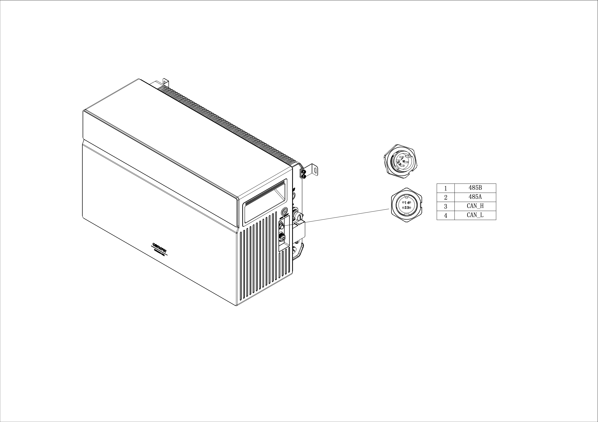
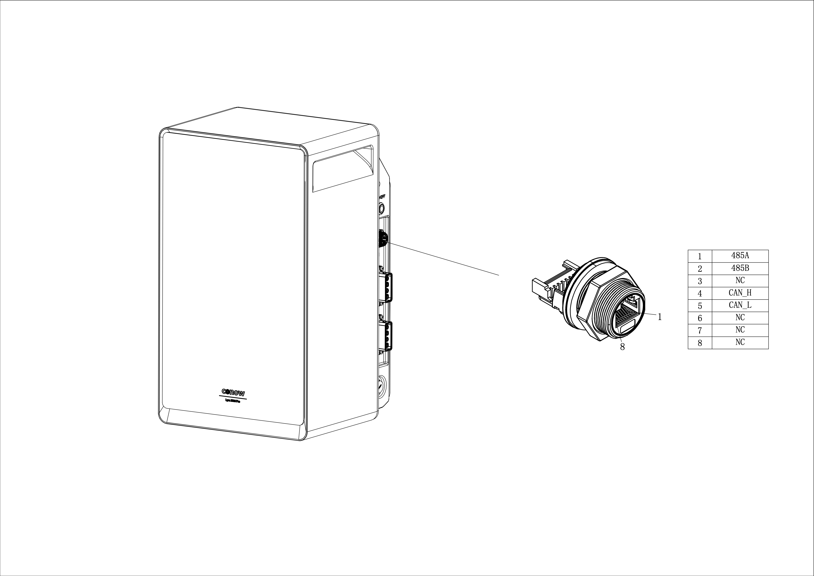

# CONOW 阳台光伏储能 — Modbus RTU API 参考

> [!IMPORTANT]
> 适用于低于 v2 最低版本的固件（v1 寄存器表）。
> 达到 v2 最低版本的固件请使用 [balcony-solar-storage-v2.zh-CN.md](balcony-solar-storage-v2.zh-CN.md)——v2 固件更新并新增了寄存器地址。

> **免责声明**：本文档由设备公开通信协议整理而成，供开发者与系统集成商参考。CONOW 保留更新文档内容与产品规格的权利，代码示例仅作参考。因不当使用导致设备故障或财产损失，CONOW 不承担任何责任，修改控制寄存器前请务必阅读制造商安全说明。

语言 / Languages / Sprache / Taal: [English](balcony-solar-storage.md) · **简体中文** · [Deutsch](balcony-solar-storage.de.md) · [Nederlands](balcony-solar-storage.nl.md)

---

## 目录

- [1 概述](#1-概述)
  - [1.1 通信参数](#11-通信参数)
  - [1.2 硬件接口](#12-硬件接口)
  - [1.3 Modbus 请求限制](#13-modbus-请求限制)
  - [1.4 使用前提](#14-使用前提)
- [2 数据类型与单位换算](#2-数据类型与单位换算)
  - [2.1 支持的数据类型](#21-支持的数据类型)
  - [2.2 换算公式](#22-换算公式)
- [3 寄存器表](#3-寄存器表)
  - [3.1 实时状态与监控（只读）](#31-实时状态与监控只读)
  - [3.2 参数设置与控制（读写）](#32-参数设置与控制读写)
- [4 帧示例](#4-帧示例)
  - [4.1 读取实时数据（FC 0x03）](#41-读取实时数据fc-0x03)
  - [4.2 写单个寄存器（FC 0x06）](#42-写单个寄存器fc-0x06)
  - [4.3 写多个寄存器（FC 0x10）](#43-写多个寄存器fc-0x10)
- [5 参考](#5-参考)
  - [5.1 系统状态位定义（寄存器 10000）](#51-系统状态位定义寄存器-10000)
  - [5.2 充放电方向控制（寄存器 10105）](#52-充放电方向控制寄存器-10105)
- [6 重要注意事项](#6-重要注意事项)

---

## 1 概述

本文档提供 CONOW 阳台光伏储能系统的完整 Modbus RTU API 参考，面向希望将设备接入 Home Assistant、OpenHAB 或自建能源管理系统（EMS）进行实时监控与控制的终端用户、开发者和系统集成商。

设备通过 RS-485 物理接口使用标准 **Modbus RTU** 协议。

### 1.1 通信参数

连接前，按以下设置配置主机侧适配器（如 RS-485 转 USB 转换器或串口服务器）：

| 参数 | 默认值 | 说明 |
| --- | --- | --- |
| 默认设备 ID | `0xA0`（十进制 160） | 可通过配置软件修改 |
| 波特率 | `38400` bps | 两侧必须一致 |
| 数据位 | `8` | 标准 |
| 停止位 | `1` | 标准 |
| 校验位 | 无 | 标准 |

### 1.2 硬件接口

#### 1.2.1 CBE2000 Pro

通过 RS-485 传输 Modbus RTU，物理接口为 4 位接线端子。

| 引脚 | 信号 |
| --- | --- |
| 1 | 485B |
| 2 | 485A |
| 3 | CAN_H |
| 4 | CAN_L |



#### 1.2.2 Lyra 系列与 Atlas

通过 RS-485 传输 Modbus RTU，物理接口为设备上的 RJ45（8P8C）插座。

| 引脚 | 信号 | 线色 | 说明 |
| --- | --- | --- | --- |
| 1 | 485A（Data +） | 白/橙 | Modbus RTU A |
| 2 | 485B（Data −） | 橙 | Modbus RTU B |
| 3 | NC | — | 不接 |
| 4 | CAN_H | — | CAN 总线信号，Modbus 不使用 |
| 5 | CAN_L | — | CAN 总线信号，Modbus 不使用 |
| 6 | NC | — | 不接 |
| 7 | NC | — | 不接 |
| 8 | NC | — | 不接 |



> 注意：
>
> - Modbus RTU 通信只需引脚 1（485A）与引脚 2（485B）。
> - **无信号地线，且无需连接。**

### 1.3 Modbus 请求限制

> [!IMPORTANT]
> 该设备对功能码 0x03 读请求的限制：单次读请求**不得超过 37 个寄存器**：
>
> - 请求 37 个及以下：正常应答。
> - 请求 38 个及以上：**设备不作任何应答**。

### 1.4 使用前提

设备必须已在 **CONOW ECO App** 中完成调试并至少上线一次——出厂未激活、从未上线的设备，RS-485 接口不响应任何请求。

1. 在 App 的 *设备 → 你的设备 → 设置* 中开启 *启用 Modbus 服务*；旧版 App 没有此开关时，改用 *设置 → 工作模式* 选择 *DIY 模式*。
2. 同一时刻只由一个主站下发写指令。

---

## 2 数据类型与单位换算

### 2.1 支持的数据类型

| 类型 | 位宽 | 范围 | 说明 |
| --- | --- | --- | --- |
| `uint16_t` | 16 位（1 个寄存器） | 0–65535 | 无符号整数 |
| `int16_t` | 16 位（1 个寄存器） | -32768 至 32767 | 有符号整数；正值=放电，负值=充电 |
| `uint32_t` | 32 位（2 个寄存器） | 0–4294967295 | 大端序；高字寄存器在前，低字寄存器在后 |

### 2.2 换算公式

Modbus 寄存器只能存储整数，带小数精度的物理量（例如电压、电量）须按倍率换算：

```text
物理值 = （原始寄存器值 − 偏移量） × 倍率
```

**示例**：读取*电池电压*（地址 10002）返回 `3200`。
倍率 = `0.01`，偏移量 = `0`。
结果：`3200 × 0.01 = 32.00 V`

---

## 3 寄存器表

### 3.1 实时状态与监控（只读）

使用 FC `0x03` 或 `0x04` 访问。这些寄存器提供实时运行数据与历史统计。

#### 系统与电池

| 地址（十进制） | 地址（十六进制） | 名称 | 类型 | 单位 | 倍率 | 备注 |
| --- | --- | --- | --- | --- | --- | --- |
| 10000 | 0x2710 | 系统状态 | uint16_t | — | — | 见 [5.1 节](#51-系统状态位定义寄存器-10000) |
| 10001 | 0x2711 | 故障码 | uint16_t | — | — | — |
| 10002 | 0x2712 | 电池电压 | uint16_t | V | 0.01 | — |
| 10003 | 0x2713 | 电池剩余容量（SoC） | uint16_t | % | 1 | 范围：0–100 |
| 10004 | 0x2714 | 电池标称容量 | uint16_t | kWh | 0.01 | — |
| 10005 | 0x2715 | 电芯最高温度 | uint16_t | °C | 0.1 | 偏移量：500；即 `（原始值 − 500）× 0.1 °C` |
| 10006 | 0x2716 | 电芯最低温度 | uint16_t | °C | 0.1 | 偏移量：500；即 `（原始值 − 500）× 0.1 °C` |
| 10007–10008 | 0x2717 | 电池累计充电量 | uint32_t | kWh | 0.01 | 占用寄存器 10007–10008 |
| 10009–10010 | 0x2719 | 电池累计放电量 | uint32_t | kWh | 0.01 | 占用寄存器 10009–10010 |

#### 电网与旁路

| 地址（十进制） | 地址（十六进制） | 名称 | 类型 | 单位 | 倍率 | 备注 |
| --- | --- | --- | --- | --- | --- | --- |
| 10011 | 0x271B | 电网有功功率 | int16_t | W | 1 | CBE：正值=向电网馈电，负值=从电网取电；Lyra / Atlas：正值=从电网取电，负值=向电网馈电 |
| 10012 | 0x271C | 电网频率 | uint16_t | Hz | 1 | 例如原始值 `50` = 50 Hz |
| 10013–10014 | 0x271D | 电网累计取电量 | uint32_t | kWh | 0.01 | 占用寄存器 10013–10014 |
| 10015–10016 | 0x271F | 电网累计馈电量 | uint32_t | kWh | 0.01 | 占用寄存器 10015–10016 |
| 10017 | 0x2721 | 旁路功率 | int16_t | W | 1 | 正值=放电；负值=充电 |
| 10018–10019 | 0x2722 | 旁路累计输出电量 | uint32_t | kWh | 0.01 | 占用寄存器 10018–10019 |
| 10020–10021 | 0x2724 | 旁路累计输入电量 | uint32_t | kWh | 0.01 | 占用寄存器 10020–10021 |

#### PV 输入

| 地址（十进制） | 地址（十六进制） | 名称 | 类型 | 单位 | 倍率 | 备注 |
| --- | --- | --- | --- | --- | --- | --- |
| 10022 | 0x2726 | PV 总输入功率 | uint16_t | W | 1 | 所有 PV 通道输入之和 |
| 10023–10024 | 0x2727 | PV 累计发电量 | uint32_t | kWh | 0.01 | 占用寄存器 10023–10024 |
| 10025 | 0x2729 | PV1 输入功率 | uint16_t | W | 1 | — |
| 10026–10027 | 0x272A | PV1 累计发电量 | uint32_t | kWh | 0.01 | 占用寄存器 10026–10027 |
| 10028 | 0x272C | PV2 输入功率 | uint16_t | W | 1 | — |
| 10029–10030 | 0x272D | PV2 累计发电量 | uint32_t | kWh | 0.01 | 占用寄存器 10029–10030 |
| 10031 | 0x272F | PV3 输入功率 | uint16_t | W | 1 | — |
| 10032–10033 | 0x2730 | PV3 累计发电量 | uint32_t | kWh | 0.01 | 占用寄存器 10032–10033 |
| 10034 | 0x2732 | PV4 输入功率 | uint16_t | W | 1 | — |
| 10035–10036 | 0x2733 | PV4 累计发电量 | uint32_t | kWh | 0.01 | 占用寄存器 10035–10036 |

---

### 3.2 参数设置与控制（读写）

使用 FC `0x03`（读）或 FC `0x06` / `0x10`（写）访问。

| 地址（十进制） | 地址（十六进制） | 名称 | 类型 | 单位 | 倍率 | 备注 |
| --- | --- | --- | --- | --- | --- | --- |
| 10100 | 0x2774 | 交流充电功率限制 | uint16_t | W | 1 | 电网对电池充电功率上限；默认 800 |
| 10101 | 0x2775 | 放电功率限制 | uint16_t | W | 1 | 并网最大输出功率；默认 800 |
| 10102 | 0x2776 | 备电 SoC | uint16_t | % | 1 | 备电预留 SoC；10–100 |
| 10103 | 0x2777 | 离网输出开关 | uint16_t | — | — | `0` = 关，`1` = 开 |
| 10104 | 0x2778 | 光伏弃光开关 | uint16_t | — | — | `0` = 关（充电 / 并网优先），`1` = 开（限制 PV 输入） |
| 10105 | 0x2779 | 充放电方向控制 | uint16_t | — | — | `0` = 空闲，`1` = 强制充电，`2` = 强制放电 |
| 10106 | 0x277A | 目标充放电功率 | uint16_t | W | — | 与寄存器 10105 配合；设定实际功率给定值 |
| 10107 | 0x277B | 充放电截止 SoC | uint16_t | % | — | 充电上限或放电下限；10–100 |

> [!WARNING]
> **强制充放电的写入顺序（FC 0x06）：**
> 逐个写寄存器时，始终按此顺序：**10106（功率）→ 10105（方向）→ 10107（截止 SoC）**。
> 建议使用原子写：将 10105 与 10106 用一帧 FC 0x10 一次性写入；若还需写入 10107，请按上一行的 FC 0x06 顺序逐个写入。

---

## 4 帧示例

所有帧均采用 Modbus RTU 编码。CRC-16 使用标准 Modbus 多项式（`0xA001`，反向）对所有前序字节计算。

### 4.1 读取实时数据（FC 0x03）

**目标**：读取*电池电压*——寄存器 `10002`（0x2712），1 个寄存器。

**请求**：

```text
A0  03  27 12  00 01  37 CA
│   │   └───┘  └───┘  └───┘
│   │     │      │      └── CRC16（小端）
│   │     │      └── 数量：1 个寄存器
│   │     └── 起始地址：0x2712（10002）
│   └── 功能码：0x03
└── 设备地址：0xA0
```

**应答**（示例——电池 32.00 V）：

```text
A0  03  02  0C 80  01 3D
│   │   │   └───┘  └───┘
│   │   │     │      └── CRC16
│   │   │     └── 数据：0x0C80 = 3200 → 3200 × 0.01 = 32.00 V
│   │   └── 字节数：2
│   └── 功能码回显：0x03
└── 设备地址回显：0xA0
```

---

### 4.2 写单个寄存器（FC 0x06）

**目标**：开启离网输出开关——寄存器 `10103`（0x2777），值 `1`。

**请求**：

```text
A0  06  27 77  00 01  EB D5
│   │   └───┘  └───┘  └───┘
│   │     │      │      └── CRC16
│   │     │      └── 值：0x0001（开启）
│   │     └── 寄存器地址：0x2777（10103）
│   └── 功能码：0x06
└── 设备地址：0xA0
```

**应答**：成功时设备原样回显请求帧。

---

### 4.3 写多个寄存器（FC 0x10）

**目标**：强制充电 1000 W——将方向（10105）与功率（10106）写入同一原子帧。

> [!NOTE]
> 本示例用 FC `0x10` 从 **10105** 起写入两个连续寄存器。
> 数据字段顺序遵循 Modbus 寄存器地址顺序：`[10105=0x0001（充电），10106=0x03E8（1000 W）]`。
> 这与 [3.2 节](#32-参数设置与控制读写)所述的 **FC 0x06 逐个写入顺序**（10106 → 10105 → 10107）不同。需要严格按该顺序时（例如还需写入 10107），请用 FC `0x06`。

**请求**：

```text
A0  10  27 79  00 02  04  00 01  03 E8  DC 90
│   │   └───┘  └───┘  │   └───┘  └───┘  └───┘
│   │     │      │    │     │      │      └── CRC16
│   │     │      │    │     │      └── 寄存器 10106：0x03E8（1000 W）
│   │     │      │    │     └── 寄存器 10105：0x0001（强制充电）
│   │     │      │    └── 字节数：4（2 个寄存器 × 2 字节）
│   │     │      └── 数量：2 个寄存器
│   │     └── 起始地址：0x2779（10105）
│   └── 功能码：0x10
└── 设备地址：0xA0
```

**应答**：

```text
A0  10  27 79  00 02  83 D4
│   │   └───┘  └───┘  └───┘
│   │     │      │      └── CRC16
│   │     │      └── 数量：2 个寄存器
│   │     └── 起始地址：0x2779（10105）
│   └── 功能码回显：0x10
└── 设备地址回显：0xA0
```

> 写单个寄存器用 FC `0x06`；原子写多个寄存器用 FC `0x10`。

---

## 5 参考

### 5.1 系统状态位定义（寄存器 10000）

寄存器 10000（系统状态）报告**电池口**的当前状态，以位域表示。各位独立解析；Bit 0 为最低位（LSB）。

| 位 | 描述 | 含义 |
| --- | --- | --- |
| Bit 0 | 待机 | `0` = 非待机，`1` = 电池口待机 |
| Bit 1 | / | 保留 |
| Bit 2 | 故障 | `0` = 正常，`1` = 有故障（读寄存器 10001） |
| Bit 3 | 充电 | `0` = 否，`1` = 电池口充电中 |
| Bit 4 | 放电 | `0` = 否，`1` = 电池口放电中 |
| Bit 5–15 | 保留 | 忽略；留作将来使用 |

**示例**：寄存器 10000 读取值为 `0x0008`（二进制 `0000 1000`），仅 Bit 3 为 1，其余位均为 0。对照上表：Bit 3（充电）= 1，即电池口正在充电。同理，读取值为 `0x0001`（二进制 `0000 0001`）时仅 Bit 0（待机）= 1，电池口处于待机。

---

### 5.2 充放电方向控制（寄存器 10105）

| 取值     | 模式   | 行为                                               |
| ------ | ---- | ------------------------------------------------ |
| 0x0000 | 空闲   | 退出强制模式                                           |
| 0x0001 | 强制充电 | 电网 → 电池；功率由寄存器 10106 设定；到寄存器 10107 设定的 SoC 停止    |
| 0x0002 | 强制放电 | 电池 → 电网/负载；功率由寄存器 10106 设定；到寄存器 10107 设定的 SoC 停止 |

> [!WARNING]
> **写入顺序（FC 0x06）**：`10106（功率）` → `10105（方向）` → `10107（截止 SoC）`。
> 建议使用原子写：将 10105 与 10106 用一帧 FC 0x10 一次性写入；若还需写入 10107，请按上一行的 FC 0x06 顺序逐个写入。
> 停止强制模式：向寄存器 10105 写 `0x0000`。

---

## 6 重要注意事项

1. **大端字序**：所有 `uint32_t` 值跨两个连续 16 位寄存器，高字寄存器地址较低。按以下方式重建 32 位值：
   ```c
   uint32_t value = ((uint32_t)reg_high << 16) | reg_low;
   ```
2. **CRC 校验**：CRC-16 错误的帧会被设备直接丢弃，不返回应答。若请求无应答，先校验 CRC，再排查接线或地址问题。
3. **写入范围限制**：向读写寄存器写入超出允许范围的值，设备会忽略，或返回 Modbus 异常应答。
4. **重试策略**：RS-485 易受电磁干扰。超时或 CRC 错误时，应实现最多 **3 次**、每次间隔不少于 **500 毫秒** 的重试机制。
5. **轮询间隔**：实时数据的轮询间隔**不得短于 2 秒**。过度轮询会使 RS-485 总线饱和，导致应答丢失。
